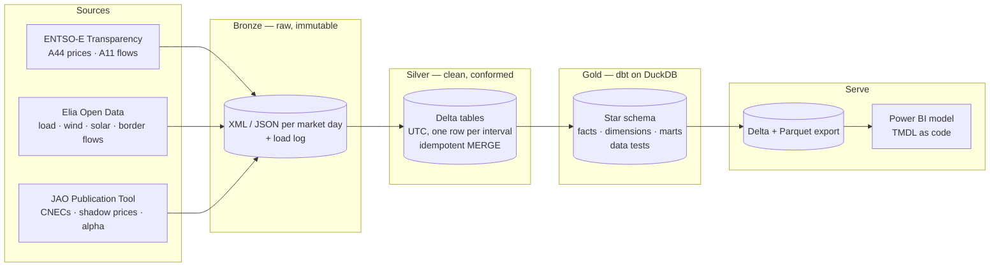

# Belgian Grid Lakehouse

A medallion lakehouse on **public European electricity data**: day-ahead prices and cross-border flows from the
ENTSO-E Transparency Platform, load and renewables from Elia Open Data, and flow-based market coupling results
from the JAO Publication Tool (Core region). It ends in a Power BI semantic model defined as code.

Built locally at zero cost with Python, Delta Lake, DuckDB and dbt, and designed to run on Microsoft Fabric
(Delta tables read by a Direct Lake semantic model).

> Personal portfolio project. Public data only.

## Architecture



| Layer | Code | What it does |
|---|---|---|
| Bronze | `ingest/bronze.py` | Downloads each **market day** (00:00–24:00 Brussels time) from the three sources and stores the response untouched, with a JSONL load log. Re-downloads the last 7 days on every daily run, because ENTSO-E and Elia revise recent data. Standard library only. |
| Silver | `transform/silver.py`, `transform/silver_jao.py` | Parses XML/JSON into Delta tables in UTC, one row per quarter-hour or hour. Idempotent `MERGE` on natural keys. Quality rules learned from real data (see below). |
| Gold | `gold/` (dbt-duckdb) | 11 staging models, 15 facts/marts/dimensions, seeds for borders, bidding zones and TSOs, generic and singular tests. |
| Serve | `serve/export_gold.py`, `serve/powerbi/` | Exports the reporting tables as Delta (for a Fabric Lakehouse) and Parquet (for Power BI Desktop). The semantic model — relationships and DAX measures — is a TMDL script. |

## What the data shows (Oct 2025 – Oct 2026)

- **Elia keeps 99.6 % of its critical network elements above the 70 % minRAM target** in Core flow-based
  market coupling (92.6 % across all Core TSOs).
- **About 300 MW flow unscheduled from the Netherlands through Belgium to France**: physical flows that do
  not match the commercial exchanges.
- **69 % of the physical flow on the Belgian–Dutch border runs against the day-ahead price signal**, driven by
  north-to-south transit.
- **ENTSO-E and Elia agree on the Belgian border flows** on almost every day, except the Dutch border, where
  ENTSO-E published hourly values until 29 June 2026 and Elia quarter-hourly ones.

## Data quality — the interesting part

Most of the work went into making two public sources that describe the same borders agree, and into
catching what the APIs do not document:

| Issue found | Rule applied |
|---|---|
| ENTSO-E returns duplicate `TimeSeries` for the same prices | Deduplicate on (zone, interval, position); stop the load if two copies disagree |
| ENTSO-E omits positions when a value repeats (`curveType` A03) | Forward-fill within the period, never zero-fill (zero-filling is off by up to 996 MW) |
| DE-LU publishes two auctions on the same day | Auction sequence is part of the key |
| Elia solar mixes country, regions and provinces in one dataset | Keep the level per row; test that regions and provinces add up to Belgium |
| Recent days change after first publication | 7-day revision window in bronze; days marked `provisional` in gold |
| Netherlands border: hourly in ENTSO-E, quarter-hourly in Elia | Compare against the hourly mean of Elia |
| Clock-change days have 92 or 100 quarter-hours | Everything stored in UTC with its Brussels market day; tests expect the right count |

Cross-source reconciliation result (`gold.mart_daily_flow_reconciliation`, 377 days per border):

| Border | OK | Minor deviation | Relevant deviation |
|---|---|---|---|
| DE | 377 | 0 | 0 |
| FR | 370 | 4 | 3 |
| GB | 366 | 11 | 0 |
| LU | 365 | 12 | 0 |
| NL | 236 | 85 | 56 |

Tolerances are dbt variables (`gold/dbt_project.yml`). The discrepancy test warns; the missing-data test
fails the build.

## Run it

Requires Python 3 and a free [ENTSO-E Transparency API token](https://transparency.entsoe.eu/).

```bash
python3 -m venv .venv && source .venv/bin/activate
pip install -r requirements.txt
echo "ENTSOE_TOKEN=<your token>" > .env          # never committed

python ingest/bronze.py --desde 2026-10-01 --hasta 2026-10-07   # bronze: raw downloads
python ingest/bronze.py --diario                                # daily run: last 7 days
python transform/silver.py                                      # silver: Delta tables
cd gold && dbt build --profiles-dir . && cd ..                  # gold: models + tests
python serve/export_gold.py                                     # serving tables
```

Data lands in `data/` (not in the repository). Gold is a DuckDB file at `data/gold/grid.duckdb`.

## Design decisions

The main choices and their trade-offs — local first, DuckDB instead of Spark, the revision window, warning
versus blocking tests — are explained in [`docs/decisions.md`](docs/decisions.md). Source-by-source findings
are in [`docs/notas-fuentes.md`](docs/notas-fuentes.md) and the report design in
[`docs/report-design.md`](docs/report-design.md).

## Data sources

Data © [ENTSO-E Transparency Platform](https://transparency.entsoe.eu/),
[Elia Open Data](https://opendata.elia.be/) and the [JAO Publication Tool](https://publicationtool.jao.eu/core/),
used under each provider's terms of use. This repository contains code only, no data.
